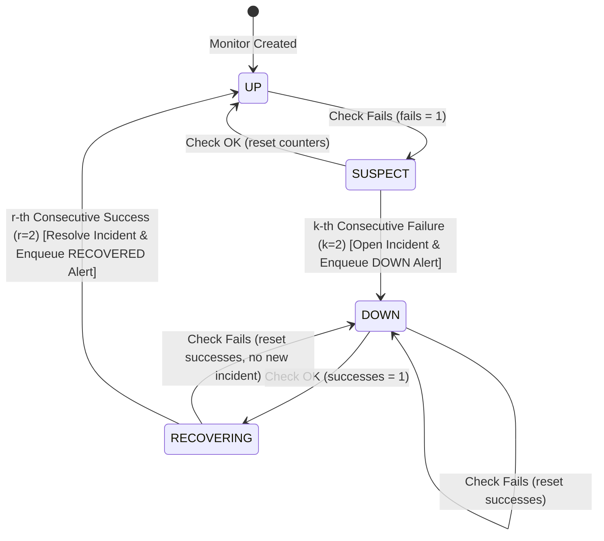

# UptimeHub &mdash; System Architecture & File-by-File Catalog

This document provides a comprehensive, file-by-file breakdown of the entire **UptimeHub** platform, detailing the architecture, design decisions, phase-by-phase implementation journey, and the exact role of every file in the codebase.

---

## 1. Architectural Design

### 1.1 High-Level Architecture Diagram

```mermaid
flowchart TD
    subgraph Client["Client Browser"]
        SPA["React 19 SPA (Vite + Tailwind v4 + Recharts)"]
    end

    subgraph Gateway["Web & Ingress Layer"]
        Nginx["Nginx Reverse Proxy (:3000 / :80)"]
    end

    subgraph BackendAPI["Backend REST API (:4000)"]
        Express["Express 5 Server"]
        AuthMiddleware["JWT Auth Middleware & Rate Limiter"]
        SSRF["SSRF Guard (DNS Resolution & IP Filter)"]
        Router["Layered Modular Routers (/api/v1)"]
    end

    subgraph DataStore["State & Message Layer"]
        Postgres[("PostgreSQL 16\n(Prisma ORM)")]
        Redis[("Redis 7\n(BullMQ v5)")]
    end

    subgraph Workers["Asynchronous Background Workers"]
        MonitorWorker["Monitor Probe Worker\n(monitor.worker.ts)"]
        NotifWorker["Notification Worker\n(notification.worker.ts)"]
    end

    subgraph TargetEndpoints["Target Services (Internet)"]
        MonitoredSites["User Web Apps & APIs"]
        MailServer["SMTP / Mail Gateway"]
    end

    SPA -->|HTTP / REST| Nginx
    Nginx -->|/api/* & /health| Express
    Nginx -->|Static Assets| SPA

    Express --> AuthMiddleware --> Router
    Router -->|Ownership Validation & SSRF Check| SSRF
    Router -->|Prisma Queries| Postgres
    Router -->|Repeatable Schedulers| Redis

    Redis -->|check-queue (monitor:id)| MonitorWorker
    Redis -->|notification-queue| NotifWorker

    MonitorWorker -->|Hard Timeout HTTP Probe| MonitoredSites
    MonitorWorker -->|Atomic Transaction: State Transition & Incident| Postgres
    MonitorWorker -->|Enqueue Alert Event| Redis

    NotifWorker -->|Read Preferences & Idempotency Check| Postgres
    NotifWorker -->|Dispatch Alert Email| MailServer
    NotifWorker -->|Update Status: SENT / FAILED| Postgres
```

---

### 1.2 State Machine Transition Flow

The incident engine implements a strictly pure, deterministic state machine operating in single database transactions:



---

## 2. Phase-by-Phase Implementation Journey

### Phase 1 &mdash; Foundation
- **Goal**: Establish the repository layout, layered backend architecture, modern frontend SPA skeleton, and root environment contracts.
- **What Was Done**:
  - Initialized Express 5 backend with NodeNext module resolution, Zod environment parsing, Pino structured logging, Helmet security headers, CORS origin whitelisting, and a centralized operational error handler.
  - Initialized React 19 frontend with Vite, Tailwind CSS v4 (`@tailwindcss/vite`), TanStack Query, and React Router v7.
  - Created root `docker-compose.yml`, root `.gitignore`, and `.env.example` configurations.
  - Implemented `/health` liveness probe.

### Phase 2 &mdash; Persistence
- **Goal**: Design the complete database schema and setup database migrations.
- **What Was Done**:
  - Implemented Prisma 6 schema with models: `User`, `Monitor`, `CheckResult`, `Incident`, `NotificationPreference`, `Notification`.
  - Configured PostgreSQL container on port `5433:5432` to avoid conflicts with existing host Postgres instances.
  - Executed initial migration (`20261101132208_init`) and created `prisma.ts` client singleton with connection pooling.
  - Authored `prisma/seed.ts` and verified persistence across container restarts.

### Phase 3 &mdash; Authentication
- **Goal**: Secure multi-tenant access control and user session management.
- **What Was Done**:
  - Implemented password hashing with `bcryptjs` (salt cost = 10) and signed JWT tokens with 7-day expiration.
  - Created authentication endpoints: `POST /api/v1/auth/register`, `POST /api/v1/auth/login`, `GET /api/v1/auth/me`.
  - Added `express-rate-limit` brute-force protection to authentication routes.
  - Built frontend `AuthContext`, `ProtectedRoute`, `Login.tsx`, and `Register.tsx`.
  - Authored automated tests verifying cross-tenant isolation (user A cannot view/edit user B's data).

### Phase 4 &mdash; First Monitor, First Check (SSRF Guard & Probes)
- **Goal**: Monitor management and safe outbound HTTP health probes.
- **What Was Done**:
  - Developed mandatory SSRF guard (`ssrf.ts`): protocol whitelist (`http:`, `https:`), DNS pre-resolution, loopback blocking (`127.0.0.1`, `::1`), private RFC1918 range blocking (`10/8`, `172.16/12`, `192.168/16`), cloud metadata blocking (`169.254.169.254`), carrier-grade NAT blocking, and redirect prevention.
  - Implemented probe engine with monotonic latency timing (`performance.now()`), strict hard timeout enforcement, and error classification (`TIMEOUT`, `DNS`, `CONNECTION`, `TLS`, `HTTP_STATUS`, `BLOCKED`, `UNKNOWN`).
  - Implemented Monitor CRUD endpoints, quota check (`MAX_MONITORS_PER_USER = 50`), and on-demand check execution (`POST /api/v1/monitors/:id/check`).

### Phase 5 &mdash; Queue and Worker Process
- **Goal**: Asynchronous background probe execution decoupled from API request threads.
- **What Was Done**:
  - Integrated BullMQ v5 and Redis with `maxRetriesPerRequest: null`.
  - Created deterministic repeatable job schedulers keyed by `monitor:<id>`.
  - Implemented queue lifecycle methods (`scheduleMonitorCheck`, `removeMonitorCheck`, `reconcileQueueJobs`).
  - Built standalone worker process (`monitor.worker.ts`) with bounded concurrency, retry backoff on job crashes, and job log trimming.

### Phase 6 &mdash; Incident Engine
- **Goal**: Automated outage detection, recovery lifecycle, and alert queue dispatch.
- **What Was Done**:
  - Implemented pure state transition engine (`UP → SUSPECT → DOWN → RECOVERING → UP`) with configurable thresholds ($k, r$).
  - Built atomic PostgreSQL transaction (`prisma.$transaction`) inserting `CheckResult`, evaluating transitions, updating monitor status, and creating/resolving `Incident` records with exact `startedAt` and `resolvedAt`.
  - Verified idempotency: duplicate queue executions produce zero duplicate incidents.
  - Enqueued alert events to isolated `notification-queue`.

### Phase 7 &mdash; Dashboard & Analytics
- **Goal**: Interactive user dashboard, visual metrics, and aggregate analytics.
- **What Was Done**:
  - Built backend analytics engine (`analytics.service.ts`): check-based uptime percentage, average latency, p95 latency (`calculateP95`), and hourly/daily time-series aggregation over `24h`, `7d`, and `30d`.
  - Exposed `GET /api/v1/monitors/:id/uptime`.
  - Frontend: Recharts area latency chart (`ResponseChart.tsx`), status badges (`StatusBadge.tsx`), modal creation dialog (`CreateMonitorModal.tsx`), Home dashboard with 15s polling, Monitor Detail view (`MonitorDetail.tsx`), and Global Incidents page (`Incidents.tsx`).

### Phase 8 &mdash; Notifications
- **Goal**: Email alert delivery, user alert preferences, and SMTP resilience.
- **What Was Done**:
  - Implemented Nodemailer email service with HTML and text templates for DOWN alerts and RECOVERY notifications (including human-readable duration calculations).
  - Built `notification.worker.ts` consuming `notification-queue`.
  - Enforced unique constraint `(incidentId, type)` on the `Notification` table to prevent duplicate emails.
  - Implemented user preferences API (`GET/PUT /api/v1/settings/notifications`) with suppression toggles (master email switch, downtime switch, recovery switch).
  - Ensured non-blocking dispatch: SMTP connection failures update status to `FAILED` with retry backoff and never block monitor checks.
  - Created frontend `Settings.tsx` page.

### Phase 9 &mdash; Hardening, E2E Verification & Dockerization
- **Goal**: Full system audit, E2E lifecycle test, production containerization, and documentation.
- **What Was Done**:
  - Implemented end-to-end integration test (`e2e.test.ts`) covering user registration, monitor creation, outage transition, DOWN alert dispatch, queue idempotency, recovery transition, RECOVERED alert dispatch, incident resolution, and analytics.
  - Configured automated redaction in Pino logger for authorization headers, cookies, passwords, and tokens.
  - Authored multi-stage production Dockerfiles for `backend/` (Node 22 Alpine) and `frontend/` (Nginx Alpine).
  - Configured full-stack `docker-compose.yml` orchestrating `postgres`, `redis`, `api`, `worker-checks`, `worker-notifications`, and `frontend`.
  - Conducted live validation against running PostgreSQL and Redis containers with 44/44 passing checks.

---

## 3. Complete File-by-File Catalog

### Root Directory
| File | Purpose |
|---|---|
| [`docker-compose.yml`](file:///wsl.localhost/Ubuntu-22.04/home/user/projects/uptimehub/docker-compose.yml) | Orchestrates all production containers: PostgreSQL 16, Redis 7, Backend API, Check Worker, Notification Worker, and Frontend Nginx web server. |
| [`.env.example`](file:///wsl.localhost/Ubuntu-22.04/home/user/projects/uptimehub/.env.example) | Root environment variable template documenting required configurations for Docker and local execution. |
| [`.gitignore`](file:///wsl.localhost/Ubuntu-22.04/home/user/projects/uptimehub/.gitignore) | Comprehensive Git ignore rules excluding `node_modules`, `dist`, `.env` secrets, coverage, and logs across the monorepo. |
| [`README.md`](file:///wsl.localhost/Ubuntu-22.04/home/user/projects/uptimehub/README.md) | Primary project documentation, architecture overview, quickstart instructions, and REST API contract. |
| [`agents.md`](file:///wsl.localhost/Ubuntu-22.04/home/user/projects/uptimehub/agents.md) | Product specification and architectural constraints defining the 10 build phases. |
| [`ARCHITECTURE.md`](file:///wsl.localhost/Ubuntu-22.04/home/user/projects/uptimehub/ARCHITECTURE.md) | This document: full architectural design, state machine flow, and comprehensive file-by-file catalog. |

---

### Backend Directory (`backend/`)

#### Configuration & Root Backend Files
| File | Purpose |
|---|---|
| [`backend/Dockerfile`](file:///wsl.localhost/Ubuntu-22.04/home/user/projects/uptimehub/backend/Dockerfile) | Multi-stage Docker build for backend: generates Prisma client, compiles TypeScript to `dist/`, deploys migrations on startup, and runs health checks. |
| [`backend/.env.example`](file:///wsl.localhost/Ubuntu-22.04/home/user/projects/uptimehub/backend/.env.example) | Environment variables example file for backend development. |
| [`backend/package.json`](file:///wsl.localhost/Ubuntu-22.04/home/user/projects/uptimehub/backend/package.json) | Node.js project manifest defining dependencies (Express 5, Prisma 6, BullMQ v5, Nodemailer, Zod, Vitest) and execution scripts (`dev`, `worker`, `worker:notifications`, `build`, `test`). |
| [`backend/tsconfig.json`](file:///wsl.localhost/Ubuntu-22.04/home/user/projects/uptimehub/backend/tsconfig.json) | TypeScript compiler options configured for `NodeNext` module resolution, strict mode, and production `dist/` compilation. |
| [`backend/vitest.config.ts`](file:///wsl.localhost/Ubuntu-22.04/home/user/projects/uptimehub/backend/vitest.config.ts) | Vitest testing configuration with `fileParallelism: false` to ensure test database isolation and sequential suite execution. |

#### Database Layer (`backend/prisma/` & `backend/src/db/`)
| File | Purpose |
|---|---|
| [`backend/prisma/schema.prisma`](file:///wsl.localhost/Ubuntu-22.04/home/user/projects/uptimehub/backend/prisma/schema.prisma) | PostgreSQL schema defining models: `User`, `Monitor`, `CheckResult`, `Incident`, `NotificationPreference`, `Notification`, and database indexes. |
| [`backend/prisma/seed.ts`](file:///wsl.localhost/Ubuntu-22.04/home/user/projects/uptimehub/backend/prisma/seed.ts) | Database seeder script creating initial development accounts and sample monitors. |
| [`backend/src/db/prisma.ts`](file:///wsl.localhost/Ubuntu-22.04/home/user/projects/uptimehub/backend/src/db/prisma.ts) | Singleton instance of `PrismaClient` with lifecycle management and connection pooling. |
| [`backend/src/db/index.ts`](file:///wsl.localhost/Ubuntu-22.04/home/user/projects/uptimehub/backend/src/db/index.ts) | Barrel export for database utilities. |

#### Core Server & Runtime (`backend/src/`)
| File | Purpose |
|---|---|
| [`backend/src/server.ts`](file:///wsl.localhost/Ubuntu-22.04/home/user/projects/uptimehub/backend/src/server.ts) | Application entry point: initializes database connections, runs BullMQ queue reconciliation, and starts HTTP server on port 4000. |
| [`backend/src/app.ts`](file:///wsl.localhost/Ubuntu-22.04/home/user/projects/uptimehub/backend/src/app.ts) | Express application factory: configures Helmet, CORS, JSON body parsers, Pino HTTP logging, API routing, and central error handlers. |
| [`backend/src/config/env.ts`](file:///wsl.localhost/Ubuntu-22.04/home/user/projects/uptimehub/backend/src/config/env.ts) | Zod schema validating all environment variables at startup (`DATABASE_URL`, `REDIS_URL`, `JWT_SECRET`, `SMTP_*`, limits). |
| [`backend/src/config/logger.ts`](file:///wsl.localhost/Ubuntu-22.04/home/user/projects/uptimehub/backend/src/config/logger.ts) | Structured Pino logger with automated redaction for passwords, tokens, JWTs, and authorization headers (Rule 12). |

#### Middleware (`backend/src/middleware/`)
| File | Purpose |
|---|---|
| [`backend/src/middleware/auth.ts`](file:///wsl.localhost/Ubuntu-22.04/home/user/projects/uptimehub/backend/src/middleware/auth.ts) | JWT authentication middleware (`requireAuth`): verifies Bearer tokens and attaches authenticated user claims to `req.user`. |
| [`backend/src/middleware/validate.ts`](file:///wsl.localhost/Ubuntu-22.04/home/user/projects/uptimehub/backend/src/middleware/validate.ts) | Request validation middleware using Zod schemas for `req.body`, `req.query`, and `req.params`. |
| [`backend/src/middleware/error-handler.ts`](file:///wsl.localhost/Ubuntu-22.04/home/user/projects/uptimehub/backend/src/middleware/error-handler.ts) | Centralized Express error handler returning consistent `{ success: false, error: { code, message } }` envelopes without leaking stack traces. |
| [`backend/src/middleware/not-found.ts`](file:///wsl.localhost/Ubuntu-22.04/home/user/projects/uptimehub/backend/src/middleware/not-found.ts) | 404 handler for unrecognized routes. |

#### Security (`backend/src/security/`)
| File | Purpose |
|---|---|
| [`backend/src/security/ssrf.ts`](file:///wsl.localhost/Ubuntu-22.04/home/user/projects/uptimehub/backend/src/security/ssrf.ts) | Mandatory SSRF guard: resolves DNS hostnames, validates resolved IPs against private/loopback/cloud-metadata blocks, and validates URLs. |
| [`backend/src/security/index.ts`](file:///wsl.localhost/Ubuntu-22.04/home/user/projects/uptimehub/backend/src/security/index.ts) | Barrel export for SSRF security functions. |
| [`backend/src/security/__tests__/ssrf.test.ts`](file:///wsl.localhost/Ubuntu-22.04/home/user/projects/uptimehub/backend/src/security/__tests__/ssrf.test.ts) | Unit tests verifying SSRF guard blocks 127.0.0.1, ::1, 169.254.169.254, 10.0.0.0/8, 192.168.0.0/16, and non-HTTP protocols. |

#### Queue System (`backend/src/queue/`)
| File | Purpose |
|---|---|
| [`backend/src/queue/connection.ts`](file:///wsl.localhost/Ubuntu-22.04/home/user/projects/uptimehub/backend/src/queue/connection.ts) | Redis connection options factory for BullMQ with `maxRetriesPerRequest: null`. |
| [`backend/src/queue/check.queue.ts`](file:///wsl.localhost/Ubuntu-22.04/home/user/projects/uptimehub/backend/src/queue/check.queue.ts) | BullMQ repeatable job manager for monitor checks (`monitor:<id>`), scheduling, removal, and startup reconciliation (`reconcileQueueJobs`). |
| [`backend/src/queue/notification.queue.ts`](file:///wsl.localhost/Ubuntu-22.04/home/user/projects/uptimehub/backend/src/queue/notification.queue.ts) | Isolated BullMQ queue for alert delivery (`notification-queue`) ensuring slow SMTP cannot delay health probes. |
| [`backend/src/queue/index.ts`](file:///wsl.localhost/Ubuntu-22.04/home/user/projects/uptimehub/backend/src/queue/index.ts) | Barrel export for queue utilities. |
| [`backend/src/queue/__tests__/queue.test.ts`](file:///wsl.localhost/Ubuntu-22.04/home/user/projects/uptimehub/backend/src/queue/__tests__/queue.test.ts) | Integration tests for queue scheduling, job lifecycle, and startup reconciliation. |

#### Workers (`backend/src/workers/`)
| File | Purpose |
|---|---|
| [`backend/src/workers/monitor.worker.ts`](file:///wsl.localhost/Ubuntu-22.04/home/user/projects/uptimehub/backend/src/workers/monitor.worker.ts) | Background worker process executing repeatable health check jobs via `check-queue` with graceful shutdown and event logging. |
| [`backend/src/workers/notification.worker.ts`](file:///wsl.localhost/Ubuntu-22.04/home/user/projects/uptimehub/backend/src/workers/notification.worker.ts) | Background worker process consuming `notification-queue` to dispatch alert emails with bounded retries and exponential backoff. |

#### Feature Modules (`backend/src/modules/`)
| File | Purpose |
|---|---|
| [`backend/src/modules/health/controller.ts`](file:///wsl.localhost/Ubuntu-22.04/home/user/projects/uptimehub/backend/src/modules/health/controller.ts) | Controller handler for `/health` liveness checks. |
| [`backend/src/modules/health/health.service.ts`](file:///wsl.localhost/Ubuntu-22.04/home/user/projects/uptimehub/backend/src/modules/health/health.service.ts) | Service returning API service name, uptime, and current timestamp. |
| [`backend/src/modules/health/index.ts`](file:///wsl.localhost/Ubuntu-22.04/home/user/projects/uptimehub/backend/src/modules/health/index.ts) | Barrel export for health module. |
| [`backend/src/modules/auth/auth.controller.ts`](file:///wsl.localhost/Ubuntu-22.04/home/user/projects/uptimehub/backend/src/modules/auth/auth.controller.ts) | Controller handlers for user registration, login, and profile retrieval. |
| [`backend/src/modules/auth/auth.service.ts`](file:///wsl.localhost/Ubuntu-22.04/home/user/projects/uptimehub/backend/src/modules/auth/auth.service.ts) | Service logic for bcrypt password hashing, JWT generation, and credential verification. |
| [`backend/src/modules/auth/auth.schema.ts`](file:///wsl.localhost/Ubuntu-22.04/home/user/projects/uptimehub/backend/src/modules/auth/auth.schema.ts) | Zod schemas for user registration and login request validation. |
| [`backend/src/modules/auth/index.ts`](file:///wsl.localhost/Ubuntu-22.04/home/user/projects/uptimehub/backend/src/modules/auth/index.ts) | Barrel export for authentication module. |
| [`backend/src/modules/auth/__tests__/auth.test.ts`](file:///wsl.localhost/Ubuntu-22.04/home/user/projects/uptimehub/backend/src/modules/auth/__tests__/auth.test.ts) | Integration tests for registration, password hashing, JWT issuance, rate limiting, and multi-tenant isolation. |
| [`backend/src/modules/monitors/monitor.controller.ts`](file:///wsl.localhost/Ubuntu-22.04/home/user/projects/uptimehub/backend/src/modules/monitors/monitor.controller.ts) | Controller handlers for monitor CRUD, pause, resume, manual trigger, and check history. |
| [`backend/src/modules/monitors/monitor.service.ts`](file:///wsl.localhost/Ubuntu-22.04/home/user/projects/uptimehub/backend/src/modules/monitors/monitor.service.ts) | Service handling quota limits, SSRF validation, BullMQ scheduler syncing, and pagination. |
| [`backend/src/modules/monitors/monitor.schema.ts`](file:///wsl.localhost/Ubuntu-22.04/home/user/projects/uptimehub/backend/src/modules/monitors/monitor.schema.ts) | Zod schemas for monitor creation and update payloads. |
| [`backend/src/modules/monitors/index.ts`](file:///wsl.localhost/Ubuntu-22.04/home/user/projects/uptimehub/backend/src/modules/monitors/index.ts) | Barrel export for monitors module. |
| [`backend/src/modules/monitors/__tests__/monitors.test.ts`](file:///wsl.localhost/Ubuntu-22.04/home/user/projects/uptimehub/backend/src/modules/monitors/__tests__/monitors.test.ts) | Tests verifying monitor ownership checks, quotas, URL validation, and pause/resume logic. |
| [`backend/src/modules/checks/check.service.ts`](file:///wsl.localhost/Ubuntu-22.04/home/user/projects/uptimehub/backend/src/modules/checks/check.service.ts) | Probe engine: monotonic clock measurement (`performance.now()`), timeout aborts, and error classification. |
| [`backend/src/modules/checks/index.ts`](file:///wsl.localhost/Ubuntu-22.04/home/user/projects/uptimehub/backend/src/modules/checks/index.ts) | Barrel export for probe checking module. |
| [`backend/src/modules/checks/__tests__/check.service.test.ts`](file:///wsl.localhost/Ubuntu-22.04/home/user/projects/uptimehub/backend/src/modules/checks/__tests__/check.service.test.ts) | Tests verifying 200 OK, 500 status codes, timeouts, DNS failures, and latency tracking. |
| [`backend/src/modules/incidents/incident.engine.ts`](file:///wsl.localhost/Ubuntu-22.04/home/user/projects/uptimehub/backend/src/modules/incidents/incident.engine.ts) | Pure state machine transition calculator and single atomic transaction executor (`processCheckResult`). |
| [`backend/src/modules/incidents/incident.controller.ts`](file:///wsl.localhost/Ubuntu-22.04/home/user/projects/uptimehub/backend/src/modules/incidents/incident.controller.ts) | Controller handlers for incident listing and detail queries. |
| [`backend/src/modules/incidents/incident.service.ts`](file:///wsl.localhost/Ubuntu-22.04/home/user/projects/uptimehub/backend/src/modules/incidents/incident.service.ts) | Queries incidents filtered by monitor and status with ownership verification. |
| [`backend/src/modules/incidents/index.ts`](file:///wsl.localhost/Ubuntu-22.04/home/user/projects/uptimehub/backend/src/modules/incidents/index.ts) | Barrel export for incidents module. |
| [`backend/src/modules/incidents/__tests__/incident.engine.test.ts`](file:///wsl.localhost/Ubuntu-22.04/home/user/projects/uptimehub/backend/src/modules/incidents/__tests__/incident.engine.test.ts) | Tests for the pure state machine logic: transitions, consecutive failure/recovery counters, and idempotency. |
| [`backend/src/modules/incidents/__tests__/incidents.api.test.ts`](file:///wsl.localhost/Ubuntu-22.04/home/user/projects/uptimehub/backend/src/modules/incidents/__tests__/incidents.api.test.ts) | API tests for incident querying and status filtering. |
| [`backend/src/modules/analytics/analytics.service.ts`](file:///wsl.localhost/Ubuntu-22.04/home/user/projects/uptimehub/backend/src/modules/analytics/analytics.service.ts) | Analytics computation: uptime %, average latency, p95 latency (`calculateP95`), and hourly/daily charting buckets. |
| [`backend/src/modules/analytics/analytics.controller.ts`](file:///wsl.localhost/Ubuntu-22.04/home/user/projects/uptimehub/backend/src/modules/analytics/analytics.controller.ts) | Controller handler for `GET /api/v1/monitors/:id/uptime`. |
| [`backend/src/modules/analytics/index.ts`](file:///wsl.localhost/Ubuntu-22.04/home/user/projects/uptimehub/backend/src/modules/analytics/index.ts) | Barrel export for analytics module. |
| [`backend/src/modules/analytics/__tests__/analytics.test.ts`](file:///wsl.localhost/Ubuntu-22.04/home/user/projects/uptimehub/backend/src/modules/analytics/__tests__/analytics.test.ts) | Tests for p95 calculations, uptime percentages, and time-series aggregation over 24h, 7d, and 30d. |
| [`backend/src/modules/notifications/email.service.ts`](file:///wsl.localhost/Ubuntu-22.04/home/user/projects/uptimehub/backend/src/modules/notifications/email.service.ts) | Nodemailer transporter setup, duration formatting, and responsive HTML/text email templates for DOWN and RECOVERED alerts. |
| [`backend/src/modules/notifications/notification.service.ts`](file:///wsl.localhost/Ubuntu-22.04/home/user/projects/uptimehub/backend/src/modules/notifications/notification.service.ts) | Notification delivery processor enforcing uniqueness `(incidentId, type)`, checking user preferences, and updating delivery status. |
| [`backend/src/modules/notifications/notification-preference.service.ts`](file:///wsl.localhost/Ubuntu-22.04/home/user/projects/uptimehub/backend/src/modules/notifications/notification-preference.service.ts) | Service to retrieve and update user notification alert preferences in PostgreSQL. |
| [`backend/src/modules/notifications/notification-preference.controller.ts`](file:///wsl.localhost/Ubuntu-22.04/home/user/projects/uptimehub/backend/src/modules/notifications/notification-preference.controller.ts) | Controller handlers for `GET/PUT /api/v1/settings/notifications`. |
| [`backend/src/modules/notifications/__tests__/notifications.test.ts`](file:///wsl.localhost/Ubuntu-22.04/home/user/projects/uptimehub/backend/src/modules/notifications/__tests__/notifications.test.ts) | Tests for preferences API, email rendering, duplicate job idempotency, alert suppression, and SMTP failure handling. |

#### Routing (`backend/src/routes/`)
| File | Purpose |
|---|---|
| [`backend/src/routes/index.ts`](file:///wsl.localhost/Ubuntu-22.04/home/user/projects/uptimehub/backend/src/routes/index.ts) | Central router aggregating `/health` and `/api/v1` route groups. |
| [`backend/src/routes/health.routes.ts`](file:///wsl.localhost/Ubuntu-22.04/home/user/projects/uptimehub/backend/src/routes/health.routes.ts) | Route definition for `GET /health`. |
| [`backend/src/routes/auth.routes.ts`](file:///wsl.localhost/Ubuntu-22.04/home/user/projects/uptimehub/backend/src/routes/auth.routes.ts) | Routes for registration, login, and profile verification with rate limiting. |
| [`backend/src/routes/monitor.routes.ts`](file:///wsl.localhost/Ubuntu-22.04/home/user/projects/uptimehub/backend/src/routes/monitor.routes.ts) | Routes for monitor CRUD, pause, resume, check history, and uptime statistics. |
| [`backend/src/routes/incident.routes.ts`](file:///wsl.localhost/Ubuntu-22.04/home/user/projects/uptimehub/backend/src/routes/incident.routes.ts) | Routes for incident list and detail endpoints. |
| [`backend/src/routes/settings.routes.ts`](file:///wsl.localhost/Ubuntu-22.04/home/user/projects/uptimehub/backend/src/routes/settings.routes.ts) | Routes for notification preferences (`/notifications`). |

#### End-to-End Test Suite (`backend/src/__tests__/`)
| File | Purpose |
|---|---|
| [`backend/src/__tests__/e2e.test.ts`](file:///wsl.localhost/Ubuntu-22.04/home/user/projects/uptimehub/backend/src/__tests__/e2e.test.ts) | Complete lifecycle E2E test verifying registration → monitor creation → outage transition → DOWN alert → recovery transition → RECOVERED alert → incident resolution → uptime analytics. |

---

### Frontend Directory (`frontend/`)

#### Configuration & Root Frontend Files
| File | Purpose |
|---|---|
| [`frontend/Dockerfile`](file:///wsl.localhost/Ubuntu-22.04/home/user/projects/uptimehub/frontend/Dockerfile) | Multi-stage Docker build: compiles Vite React SPA to static assets and serves them via Nginx Alpine with client-side routing fallback. |
| [`frontend/nginx.conf`](file:///wsl.localhost/Ubuntu-22.04/home/user/projects/uptimehub/frontend/nginx.conf) | Nginx configuration enabling gzip, SPA routing fallback (`try_files $uri $uri/ /index.html`), and reverse proxy for `/api/` and `/health`. |
| [`frontend/.env.example`](file:///wsl.localhost/Ubuntu-22.04/home/user/projects/uptimehub/frontend/.env.example) | Example environment file specifying `VITE_API_URL`. |
| [`frontend/package.json`](file:///wsl.localhost/Ubuntu-22.04/home/user/projects/uptimehub/frontend/package.json) | Frontend project manifest with dependencies: React 19, Vite, Tailwind CSS v4, TanStack Query, Axios, Recharts, Lucide Icons. |
| [`frontend/tsconfig.json`](file:///wsl.localhost/Ubuntu-22.04/home/user/projects/uptimehub/frontend/tsconfig.json) | Project TypeScript configuration referencing app and node tsconfigs. |
| [`frontend/tsconfig.app.json`](file:///wsl.localhost/Ubuntu-22.04/home/user/projects/uptimehub/frontend/tsconfig.app.json) | TypeScript configuration for client React code. |
| [`frontend/tsconfig.node.json`](file:///wsl.localhost/Ubuntu-22.04/home/user/projects/uptimehub/frontend/tsconfig.node.json) | TypeScript configuration for Vite build tools. |
| [`frontend/vite.config.ts`](file:///wsl.localhost/Ubuntu-22.04/home/user/projects/uptimehub/frontend/vite.config.ts) | Vite build configuration integrating React 19 and `@tailwindcss/vite`. |
| [`frontend/index.html`](file:///wsl.localhost/Ubuntu-22.04/home/user/projects/uptimehub/frontend/index.html) | HTML entry document mounting the React root. |

#### Source Code (`frontend/src/`)
| File | Purpose |
|---|---|
| [`frontend/src/main.tsx`](file:///wsl.localhost/Ubuntu-22.04/home/user/projects/uptimehub/frontend/src/main.tsx) | Application bootstrap mounting React DOM with TanStack Query provider and React Router. |
| [`frontend/src/App.tsx`](file:///wsl.localhost/Ubuntu-22.04/home/user/projects/uptimehub/frontend/src/App.tsx) | Top-level React component providing `AuthProvider` and `RouterProvider`. |
| [`frontend/src/index.css`](file:///wsl.localhost/Ubuntu-22.04/home/user/projects/uptimehub/frontend/src/index.css) | Global stylesheet importing Tailwind CSS v4 directives. |
| [`frontend/src/types/index.ts`](file:///wsl.localhost/Ubuntu-22.04/home/user/projects/uptimehub/frontend/src/types/index.ts) | Shared TypeScript interfaces: `User`, `Monitor`, `CheckResult`, `Incident`, `UptimeStats`, `TimeSeriesPoint`, `NotificationPreference`. |

#### API Client Layer (`frontend/src/api/`)
| File | Purpose |
|---|---|
| [`frontend/src/api/client.ts`](file:///wsl.localhost/Ubuntu-22.04/home/user/projects/uptimehub/frontend/src/api/client.ts) | Axios singleton configured with base URL and automatic `Authorization: Bearer <token>` injection interceptor. |
| [`frontend/src/api/auth.ts`](file:///wsl.localhost/Ubuntu-22.04/home/user/projects/uptimehub/frontend/src/api/auth.ts) | API calls for registration, login, and current user retrieval. |
| [`frontend/src/api/monitors.ts`](file:///wsl.localhost/Ubuntu-22.04/home/user/projects/uptimehub/frontend/src/api/monitors.ts) | API calls for monitor CRUD, pause/resume, on-demand checks, check history, and uptime statistics. |
| [`frontend/src/api/incidents.ts`](file:///wsl.localhost/Ubuntu-22.04/home/user/projects/uptimehub/frontend/src/api/incidents.ts) | API calls for listing incidents and fetching incident details. |
| [`frontend/src/api/settings.ts`](file:///wsl.localhost/Ubuntu-22.04/home/user/projects/uptimehub/frontend/src/api/settings.ts) | API calls for fetching and updating user notification alert settings. |
| [`frontend/src/api/health.ts`](file:///wsl.localhost/Ubuntu-22.04/home/user/projects/uptimehub/frontend/src/api/health.ts) | API call for checking server `/health`. |
| [`frontend/src/api/index.ts`](file:///wsl.localhost/Ubuntu-22.04/home/user/projects/uptimehub/frontend/src/api/index.ts) | Barrel export for API client functions. |

#### State & Routing (`frontend/src/features/` & `frontend/src/routes/`)
| File | Purpose |
|---|---|
| [`frontend/src/features/auth/AuthContext.tsx`](file:///wsl.localhost/Ubuntu-22.04/home/user/projects/uptimehub/frontend/src/features/auth/AuthContext.tsx) | React Context managing authentication state, token storage in localStorage, automatic session restoration, and logout. |
| [`frontend/src/routes/index.tsx`](file:///wsl.localhost/Ubuntu-22.04/home/user/projects/uptimehub/frontend/src/routes/index.tsx) | React Router v7 configuration registering public, protected, and 404 routes. |
| [`frontend/src/routes/ProtectedRoute.tsx`](file:///wsl.localhost/Ubuntu-22.04/home/user/projects/uptimehub/frontend/src/routes/ProtectedRoute.tsx) | Route guard redirecting unauthenticated visitors to `/login`. |

#### UI Components (`frontend/src/components/`)
| File | Purpose |
|---|---|
| [`frontend/src/components/Layout.tsx`](file:///wsl.localhost/Ubuntu-22.04/home/user/projects/uptimehub/frontend/src/components/Layout.tsx) | Main layout wrapper with responsive navbar, active tab indicators (Monitors, Incidents, Settings), user badge, sign-out button, and footer. |
| [`frontend/src/components/StatusBadge.tsx`](file:///wsl.localhost/Ubuntu-22.04/home/user/projects/uptimehub/frontend/src/components/StatusBadge.tsx) | Visual status badges with color coding and animations for `UP`, `SUSPECT`, `DOWN`, and `RECOVERING`. |
| [`frontend/src/components/ResponseChart.tsx`](file:///wsl.localhost/Ubuntu-22.04/home/user/projects/uptimehub/frontend/src/components/ResponseChart.tsx) | Responsive Recharts area chart displaying dual trend curves (average latency and p95 latency) with interactive tooltips. |
| [`frontend/src/components/CreateMonitorModal.tsx`](file:///wsl.localhost/Ubuntu-22.04/home/user/projects/uptimehub/frontend/src/components/CreateMonitorModal.tsx) | Modal dialog for creating monitors with URL validation and customizable check intervals and timeouts. |

#### Pages (`frontend/src/pages/`)
| File | Purpose |
|---|---|
| [`frontend/src/pages/Home.tsx`](file:///wsl.localhost/Ubuntu-22.04/home/user/projects/uptimehub/frontend/src/pages/Home.tsx) | Main dashboard: displays executive KPI summary cards, monitor list with live status, on-demand probe triggers, pause/resume/delete actions, and 15s auto-polling. |
| [`frontend/src/pages/MonitorDetail.tsx`](file:///wsl.localhost/Ubuntu-22.04/home/user/projects/uptimehub/frontend/src/pages/MonitorDetail.tsx) | Detailed monitor analytics view: range switcher (`24h`, `7d`, `30d`), uptime cards, latency area chart, recent checks table, and monitor incident log. |
| [`frontend/src/pages/Incidents.tsx`](file:///wsl.localhost/Ubuntu-22.04/home/user/projects/uptimehub/frontend/src/pages/Incidents.tsx) | Global incident tracking page with filter tabs (All, Open Outages, Resolved), search, duration calculations, and links to affected monitors. |
| [`frontend/src/pages/Settings.tsx`](file:///wsl.localhost/Ubuntu-22.04/home/user/projects/uptimehub/frontend/src/pages/Settings.tsx) | Settings page allowing users to review profile and toggle master email alerts, downtime alerts, and recovery alerts with auto-save feedback. |
| [`frontend/src/pages/Login.tsx`](file:///wsl.localhost/Ubuntu-22.04/home/user/projects/uptimehub/frontend/src/pages/Login.tsx) | Sign-in page with credential validation and redirection. |
| [`frontend/src/pages/Register.tsx`](file:///wsl.localhost/Ubuntu-22.04/home/user/projects/uptimehub/frontend/src/pages/Register.tsx) | Registration page for new user account creation. |
| [`frontend/src/pages/NotFound.tsx`](file:///wsl.localhost/Ubuntu-22.04/home/user/projects/uptimehub/frontend/src/pages/NotFound.tsx) | 404 error page with navigation button back to Home. |

